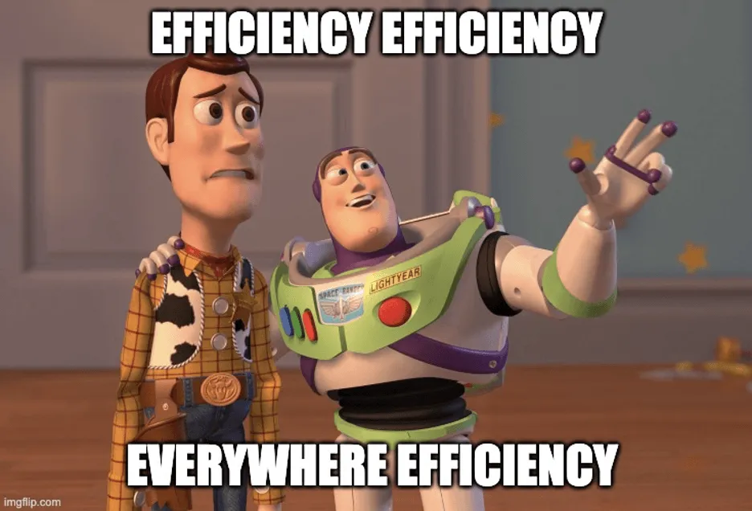

Das ist eine Verlinkung zu einem Beitrag, der zusammen mit meinem Studienkollegen Fabian Luggert entstanden ist:

<figure style="text-align: center;"></figure>

Während unseres Studiums (und heute noch viel mehr) waren wir ständig mit den Begriffen „effizient“ oder „ineffizient“ konfrontiert. Nicht nur in Diskussionen und weniger fundierten Gesprächen, sondern auch in wissenschaftlichen Papieren wurde der Begriff „Effizienz“ oft ohne Kontext verwendet, was zu Missverständnissen führen kann. In den meisten Fällen wurde Effizienz implizit als „output-bezogen“ interpretiert, was auf eine stillschweigende Übereinstimmung im Bereich der Organisationsstudien hinweist, dass das Ziel von Organisationen oft Gewinnmaximierung ist. Diese einseitige Sichtweise könnte jedoch wichtige Perspektiven und Einsichten ausschließen, insbesondere in einer Welt, in der unterschiedliche Organisationen vielfältige Ziele verfolgen. Unsere Diskussion führte uns zu der Erkenntnis, dass eine präzisere Verwendung des Begriffs „Effizienz“ notwendig ist, um Missverständnisse zu vermeiden und die Vielfalt der Organisationsziele besser zu berücksichtigen. Wir hoffen, dass dieser Beitrag zur Diskussion über die Notwendigkeit beiträgt, den Begriff „Effizienz“ in der wissenschaftlichen Gemeinschaft und in den Vorlesungssälen genauer zu definieren und zu hinterfragen. Hier der [Link](https://osconjunction.net/2020/10/14/efficiency-efficiency-everyhwere-efficiency-from-a-linguistic-detail-to-a-paradigm-in-organization-studies/#more-1153) zu dem ausführlicheren Beitrag in Englisch.
