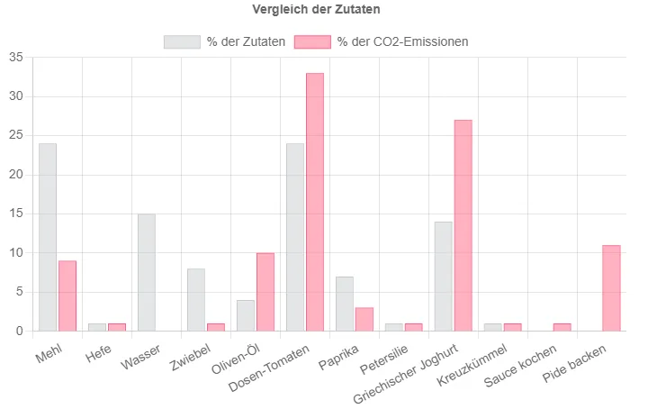

- Ich empfehle euch die Webseite www.klimafreundlicher-kochen.de
- Sie gibt Rezeptvorschläge inclusive dem dezugehörigen CO2 Fußabdruck
- Wenn ihr euren Fußabdruck im Bereich Ernährung reduzieren wollt, dann ist diese Seite eine tolle Hilfe!

Ich möchte euch eine Webseite empfehlen! Über diese bin ich gestolpert, als ich diesen Blog/diese Webseite erstellt habe, da sie das gleiche Hugo-Theme ([congo](https://github.com/jpanther/congo)) verwenden. Ich habe mich durch die einzelnen Beispielseiten geklickt, die das Thema verwenden, nur um zu schauen, wie andere das Thema umgesetzt haben und was sich alles machen lässt.

Schon die URL www.klimafreundlicher-kochen.de hat meine Aufmerksamkeit auf sich gezogen und ich wurde nicht enttäuscht. Auf dieser Webseite präsentiert Max verschiedene Rezepte. Soweit nichts Besonderes, aber was diesen Blog besonders macht, ist, dass es zu jedem Rezept einen CO2-Fußabdruck dazu gibt. Die Mengen sind immer für ca. 2 Personen angegeben und die CO2-Daten werden aus Lebenszyklus-Analyse-Studien gewonnen.

Mir gefallen an diesem Blog drei Aspekte:
## Der direkte Link zwischen Rezept und dem jeweiligen CO2 Fußabdruck
Es ist allgemein bekannt, dass unsere Ernährung und die Art und Weise, wie unser Nahrungssystem global organisiert ist, für einen erheblichen Teil der Verantwortung verantwortlich ist. Es ist auch bekannt das Tierische Produkte mehr Emissionen verursachen als pflanzliche. Aber welche Zutaten verursachen wieviel CO2?
Auf www.klimafreundlicher-kochen.de ist für jedes Rezept dargestellt, welchen Anteil die jeweiligen Zutaten am Gericht und am CO2-Fußabdruck des Gerichtes haben. Für alle, die sehen wollen, wieviel ein Gericht an Emissionen verursacht, und welche Produkte besonders große Auswirkungen haben, ist diese Darstellung wirklich genial.

Hier ein Beispiel von einer [vegetarischen Pide](https://www.klimafreundlicher-kochen.de/rezept/vegetarische-pide/).

<figure style="text-align: center;"></figure>

## Die Transparenz
Zum einen beschreibt Max, wie er den CO2-Fußabdruck des jeweiligen Berichts berechnet und dass es sich nur um eine Schätzung handelt. Dazu zählt auch, was alles nicht mit eingerechnet wird, z.B. der Einkaufsweg. Außerdem stellt er alle Quellen zur Verfügung (inklusive einer Übersichtstabelle aller Lebensmittel und deren CO2-Fußabdrücke), die er verwendet. Am meisten begeistert mich jedoch der Aufruf: wenn jemand Vorschläge oder Daten hat, mit denen die Schätzungen verbessert werden können, soll er sich doch bei Max per E-Mail melden. (Wenn ich so etwas lese, bekommen die Autor:innen bei mir immer direkt Pluspunkte 😜)

## Die Einordnung der Nahrungsthematik zum Klimawandel
Es isst klar, dass eine Ernährung mit einem geringen CO2-Fußabdruck nicht die Klimakrise löst, aber trotzdem hat unser globales Ernährungssystem einen Anteil von 34 % an den globalen Treibhausgasemissionen ([Quelle - Nature](https://www.nature.com/articles/s43016-021-00225-9)).

Damit hat die Art und Weise, wie wir uns als Menschheit ernähren, einen relevanten und erheblichen Einfluss auf das Klima. Wie Max schreibt: “Wenn wir drei Mal am Tag etwas essen, dann haben wir jedes Jahr über 1000 Möglichkeiten, uns zu entscheiden, wie klimafreundlich wir uns ernähren”. Er sagt außerdem und diesen Standpunkt teile ich: Es lässt sich beim Essen und Kochen gut experimentieren, was alles geht. Da wir jeden Tag essen, ist es nichts Weltbewegendes, wenn mal ein Rezept nicht schmeckt. Dadurch kann man hier viel ausprobieren, ohne direkt fundamentale Entscheidungen und Investitionen zu treffen.

---
**Viel Spaß beim Kochen & Essen!**
