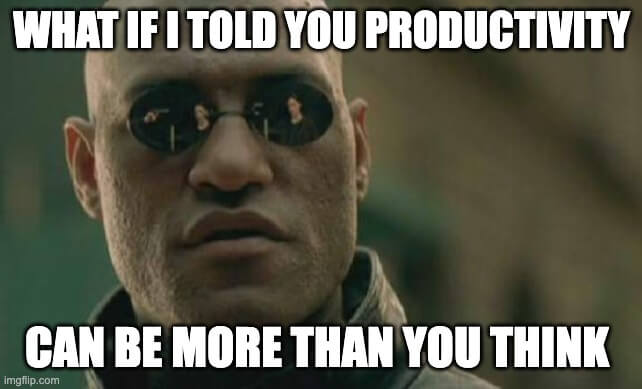

<figure style="text-align: center;"></figure>

Ich glaube, dass individuelle Produktivitätssysteme viel mehr leisten können als nur effektiveres Arbeiten zu ermöglichen. Für mich ist ein Produktivitätssystem dann gut, wenn es Routinen und Praktiken beinhaltet, die dazu beitragen:

- unser Wohlbefinden zu steigern,
- einen besseren Umgang mit bestehenden Notwendigkeiten oder Situationen wie zum Beispiel einem nicht endenden Strom an anstehenden Aufgaben zu ermöglichen,
- und uns mehr Zeit für "nicht-notwendige" Aktivitäten zu geben, die uns einfach große Freude bereiten. 

Insbesondere der letzte Punkt findet meines Erarchtens zu wenig beachtung 💯

Als ich darüber nachdachte, diese Webseite aufzusetzen, war eine meiner ersten Ideen, über "mein" Produktivitätssystem zu schreiben. Nicht weil ich denke, dass es besonders herausragend ist, sondern hauptsächlich, weil mich einige Freunde und Bekannte gefragt haben, wie ich es geschafft habe, zwei Master-Abschlüsse, ein Erweiterungsstudium und meine Teilzeit-Freiberuflichkeit unter einen Hut zu bekommen. Die Antwort darauf ist "mein" Produktivitätssystem, das im Wesentlichen aus einigen grundlegenden, routinemäßigen Praktiken und Regeln besteht, die ich anwende. Dieses System hat sich Schritt für Schritt organisch entwickelt und tut es immer noch.

Seit ich an dem Post über mein System schreibe, merke ich, dass der Text einen Vibe bekommt, der mir nicht gefällt und den ich bei vielen Produktivitäts-Gurus und Erfolgcoaches kritisiere. Der Vibe lässt sich am besten beschreiben mit: "Bei Produktivität geht es darum, mehr aus sich rauszuholen, besser zu werden, mehr zu leisten". Es wirkt auf mich häufig wie die unreflektierte Aussage: "Mehr ist immer besser". Insbesondere aus linken Kreisen wird der Produktivitätshype häufig kritisiert, weil er die Inkarnation des Kapitalismus ist. Zum Teil stimme ich dieser Aussage auch zu, jedoch teile ich nicht die Kritik, die bei der Produktivität an sich ansetzt.

Was meine ich damit? Produktivität an und für sich ist ein relatives ökonomisches Maß für das Verhältnis von Input zu Output. Liefert ein System B mehr Output bei gleichem Input als das System A, so ist das System B produktiver. Der Produktivitätshype zielt darauf ab, mehr aus sich herauszuholen, also mit den vorhandenen Ressourcen einen höheren Output zu generieren. Soweit so gut könnte man meinen, aber hier kommt Fluch und Segen des Begriffes Output ins Spiel.

Output ist zwar allgemein verständlich und auf alle Bereiche übertragbar. Durch diese Übertragbarkeit ist die Zielgruppe für persönliche Produktivitätssteigerung riesig. Alle kennen die Situation, dass man mehr machen möchte, als man Zeit und/oder Energie hat. Wenn ich es schaffe, schneller Aufgaben zu erledigen, kann ich noch andere Dinge tun - grundsätzlich erstrebenswert oder. Die Kehrseite davon ist, dass der Begriff Output unglaublich unspezifisch ist. Ähnlich wie der Begriff Effizienz ( [Efficiency, Efficiency, Everyhwere Efficiency: From a Linguistic Detail to a Paradigm in Organization Studies – ConJunction (osconjunction.net)](https://osconjunction.net/2020/10/14/efficiency-efficiency-everyhwere-efficiency-from-a-linguistic-detail-to-a-paradigm-in-organization-studies/)) ist die Produktivität immun gegen die Frage des qualitativen Outputs. Produktivitätssteigerung fragt nicht nach dem, WAS wir erreichen wollen, sondern nur nach dem WIE können wir mehr von dem WAS (auch immer) erreichen.

(Disklaimer: jetzt wird es ein bisschen verkopft ….) Meiner Meinung nach führt die Fokussierung auf das "Wie" der Produktivität und die Abstraktion vom "Was" dazu, dass wir uns von der Frage entfernen, was wir eigentlich wollen, oder anders ausgedrückt, warum wir bestimmte Aufgaben oder Bereiche produktiver gestalten wollen. Wenn ich den ersten Absatz dieses Posts lese, habe ich den Eindruck, dass viele Befürworter:innen von Produktivität diese "Warum"-Frage zumindest unbewusst mit "weil man dann mehr machen kann" beantworten. Mehr Projekte, mehr Bücher lesen, mehr Aufgaben übernehmen - you-name-it. Ich will nicht leugnen, dass auch ich von diesem "Mehr" motiviert war. Ich wollte meine zwei Masterabschlüsse und das Erweiterungsstudium absolvieren. Ich wollte mehr wissenschaftliche Artikel für meine Masterarbeiten lesen, hatte aber nur wenige Stunden am Tag, in denen ich wirklich konzentriert Inhalte aufnehmen konnte. 

Meine Erklärung (ohne eine gescheite Analyse gemacht zu haben), warum ich und viele andere Menschen immer wieder den Drang nach MEHR individueller Produktivität verspüren, ist die Parallele zur kapitalistischen Produktivitätsperspektive und dem fundamentalen Wachstumsparadigma, das wir im globalen Norden seit unserer Kindheit erlebt haben.

<figure style="text-align: center;"></figure>

Die Vorstellung von konstantem Wachstum im Bereich der individuellen Produktivität erscheint absurd. Ein Zitat aus dem vielgelesenen und gehypten Buch "Atomic Habits" verdeutlicht dies: "Wenn du dich jeden Tag um 1% verbesserst, bist du nach einem Jahr 37-mal besser" (frei übersetzt) . Dieses Zitat ist ein hervorragendes Beispiel für die Abstraktion des WAS und der Fokus auf das WIE. Wenn ich jeden Tag 1% Besser werden (Wie sieht 1% Besser eigentlich aus?) dann bin ich am Ende des Jahres 37mal besser - Wait WHAT?. Das Zitat verdeutlicht, warum dieses Paradigma in der Produktivitäts-Blase so vorherrscht. Zwar waren viele Passagen aus dem Buch nützlich und haben neue Gedanken angeregt, und ja das Zitat ist mit Sicherheit (hoffentlich) nicht wörtlich gemeint, trotzdem zeigt es welches Paradigma in der Produktivitätsbuble so vorherrscht

Mein System entstand aus dem Wunsch heraus, zu testen, ob ich zwei Masterstudiengänge gleichzeitig bewältigen kann. Dazu musste ich alle Aufgaben, Vorlesungen, Prüfungen und Deadlines koordinieren. Schnell stellte ich jedoch fest, dass ich nicht abschalten konnte und immer das Gefühl hatte, nicht genug getan zu haben. Trotzdem wollte ich auch noch mein Vorhaben, das Erweiterungsstudium in der gleichen Zeit durchzuführen, umsetzen. Mit jeder neuen Anforderung habe ich etwas ausprobiert, um diese Aufgabenfülle zu bewältigen. Wenn es mir die Arbeit erleichterte oder meine Vorhaben ermöglichte, war ich zufrieden und setzte noch etwas drauf - im Nachhinein an verschiedenen Stellen ziemlich dämlich. Ehrlich gesagt, war eine Motivation, mir immer mehr aufzuladen, auch der Test: Schaffe ich das? Wann fahre ich gegen die Wand? Und ich bin es. Aber der Hauptgrund, warum die 10 Monate mit zwei Masterarbeiten und dem Eintauchen in Data Science so eine schöne und fordernde Zeit waren, war, weil es mir Freude gemacht hat. Leider hatte und habe ich ein Übergewicht auf der Arbeit, was mir langfristig nicht guttut. Manchmal habe ich es geschafft, so viel Abstand vom Studium zu bekommen, dass ich mich ungeplant Dingen und Aktivitäten hingegeben habe. Diese Phasen habe ich unglaublich genossen und waren häufiger Anstoß für sehr produktive Veränderungen und Ideen. Mein aktuelles Ziel ist es, mein Produktivitätssystem so umzugestalten, dass es mir mehr solcher Phasen ermöglicht.

Warum schreibe ich das alles? Wie eingangs beschrieben, war ich überrascht über den Ton, den meine Systembeschreibung angenommen hat. Warum er diesen Ton angenommen hat (und vielleicht auch immer noch hat), weiß ich nicht. Möglicherweise kopiere ich den Ton von anderen oder er wird eher im Subtext transportiert. Als ich dies feststellte, versuchte ich mein System kritisch zu hinterfragen und stellte mir explizit die Frage: "Was versuchst du zu erreichen, indem du die Praktiken anwendest und den von dir aufgestellten Regeln folgst?" Meine Antwort darauf war dreiteilig:

1. Das System reduziert meine Belastung und den Druck, den ich mir mache. Ich schreibe mir alles auf, was ich glaube, was wichtig ist, und dank Obsidian (thank me later 😉) finde ich es auch wieder! Dieses Wissen, sehr wenig zu vergessen, hilft mir enorm.
2. Es gibt mir Sicherheit und schafft Abstand. Ich habe fest eingeplante Zeitslots, und an denen geht nichts vorbei! In diesen plane ich meine anstehenden Aufgaben und reflektiere am Ende der Woche, was war. Diese Praktiken ermöglichen es mir, einen Schritt zurückzutreten und auf das große Ganze zu blicken. Das gibt mir Sicherheit, wenn es unübersichtlich wird, und schafft Distanz und Raum für anderes.
3. Ich mag es, meine Zeit effektiv zu nutzen, und ich glaube, dass das System hilft, dies zu erreichen.
(Anmerkung am Rande: Schaffe ich es immer, diese Ziele durch mein System zu erreichen? NOP! Das ist aber auch nicht schlimm, für mich geht es darum, in eine Richtung zu gehen, die mein Wohlbefinden steigert.)

Mehr zu leisten ist also nur ein Teil und tatsächlich nur (etwas zugespitzt) ein Beiprodukt von meinem System. Diese Erkenntnis hat mich überrascht und ist der Grund für diesen Post. Ich glaube nämlich, dass ein Produktivitätssystem, das zu einer Person passt, viel mehr und wichtigeres leisten kann als eine stupide Output-Erhöhung. 

Mein Plädoyer für eine "sinnvolle" Perspektive auf Produktivität ist: Wir sollten uns mehr Gedanken darüber machen, was wir erreichen wollen, bevor wir uns Hals über Kopf in die Frage stürzen, wie wir es erreichen können. Für mich bedeutet ein Produktivitätssystem, dass es mir guttut und meine Bedürfnisse befriedigt werden können. Wir sind alle mit verschiedenen Aufgaben und Arbeiten konfrontiert, die zum Leben dazugehören. Sei es Lohnarbeit, Bildung, der Haushalt, die Familie oder Ehrenamt etc., all diese Notwendigkeiten müssen erledigt werden. Ein Produktivitätssystem sollte meiner Meinung nach diese Notwendigkeiten mit möglichst wenig Aufwand und möglichst wenig “Verausgabung von _menschlichem_ Hirn, Muskel, Nerv, Hand" (um einmal Marx zu zitieren 😉) erledigen, um mehr Zeit für sich und die nicht-notwendigen Dinge zu haben.
