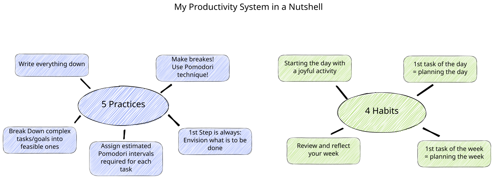

5 Praktiken und 4 Gewohnheiten, um möglichst effektiv zu arbeiten, die empfundene Belastung zu reduzieren, nach der Arbeit abzuschalten und ausreichend Freizeit zu haben.

<figure style="text-align: center;"></figure>

Dies ist eine Übersicht über mein persönliches Produktivitätssystem, das ich während meines Masterstudiums entwickelt und weiterentwickelt habe. Es entstand aus der Notwendigkeit, zwei Masterprogrammen und einem Erweiterungsprogramm zu absolvieren und gleichzeitig als Freiberufler zu arbeiten. Es baut auf vielen bestehenden Erkenntnissen auf und wurde durch Zusammenfassungen von YouTubern und Mitgliedern der Obsidian-Community sowie anderen Büchern und Artikeln angepasst. **Das System ist eigentlich ziemlich einfach und basiert auf 5 Praktiken und 4 Gewohnheiten.**

Im Laufe der Zeit haben sich die Anforderungen an das System verändert, insbesondere habe ich festgestellt, dass es mir schwer fällt, genug Freizeit und Zeit mit meinen Lieben zu verbringen. Außerdem konnte ich zwar immer mehr erledigen, aber dadurch wurde die gefühlte Belastung nicht reduziert. Daher hat sich das System immer wieder verändert und ich habe versucht, durch neue oder adaptierte Praktiken und Gewohnheiten einen Weg zu finden, der meine Bedürfnisse erfüllt:

**Die Funktionen, die mein System erfüllt, sind die folgenden:**
- Meine Arbeitszeit möglichst effektiv zu nutzen
- Reduktion der gefühlten Belastung
- Möglichkeit zum Abschalten
- Nicht mehr Aufgaben/Projekte zu machen, als ich in dem zugewiesenen Zeitkontingent realistisch schaffen kann
- Genug Freizeit und Zeit mit wichtigen Menschen zu ermöglichen

Wichtig ist auch: Regeln sind dazu da, gebrochen zu werden: Ich habe oft versucht, das perfekte System für mich umzusetzen und jede Regel sehr streng zu befolgen. Wenn ich zum Beispiel vergessen hatte, alles aufzuschreiben, wurde ich wütend auf mich selbst. Aber die Praktiken und Gewohnheiten sind kein Selbstzweck sie helfen ruhiger, gelassener und widerstandsfähiger gegenüber überwältigenden Aufgaben zu werden. Wenn man mal keine Lust hat oder Gewohnheiten oder Praktiken nicht erfüllt durchgeführt werden, ist das okay und total in Ordnung!

## Fünf Praktiken
Diese fünf Praktiken bilden das Fundament des Systems und stellen gewissermaßen Regeln oder Ratschläge dar, denen ich folge.

### Alles aufschreiben
Der **Zweck dieser Praktik** besteht darin, den Geist frei zu machen und das Gehirn zum Denken und Kreativsein zu nutzen und nicht zum Speichern oder Erinnern von Dingen. Dies basiert auf dem Zitat von David Allen und wird von vielen Menschen zitiert: "Dein Geist ist dazu da, Ideen zu haben, nicht sie festzuhalten".

**Wie funktioniert es:**
Die praktische Konsequenz lautet: "Immer wenn dir eine Aufgabe oder eine Idee in den Sinn kommt, schreibe sie auf". Ich nutze Stift und Papier sowie OBSIDIAN, um alles festzuhalten, was mir in den Sinn kommt.

Übrigens: Wenn ich ein Software-Tool nennen müsste, das in den letzten 5-10 Jahren am meisten Einfluss auf meine Arbeitsweise und mein Denken hatte, dann ist es definitiv Obsidian. Es lohnt sich wirklich, einen Blick darauf zu werfen. Suche auf Youtube nach Obsidian, aber verliere dich nicht zu sehr in diesem Kaninchenbau.

es ist die erste Praktik meines Produktivitätssystems. Leider weiß ich nicht mehr, wo ich darauf gestoßen bin. Google einfach die "Pomodori-Technik" und du findest eine Menge Blogartikel zu dieser Praktik.

### Pomodori Technik und Pausen machen
Für mich besteht **der Zweck dieser Praktik** darin:
1. Mental: Die Arbeit wird machbare Häppchen aufgeteilt, was mich entlastet. Eine 4-stündige Lernsession scheint sehr schwer, aber 8 Blöcke von jeweils 25 Minuten + Pausen dazwischen scheinen für mich nicht so schlimm. Dadurch kann ich mich auf eine bestimmte Aufgabe konzentrieren und werde nicht von der Sorge übermannt ob ich die Aufgabe erledigen kann.
2. Meine Konzentrationsfähigkeit nimmt nicht linear ab, sondern eher abrupt, besonders beim Studieren oder Lesen (nicht so sehr bei kreativen Tätigkeiten).
3. Regelmäßige Pausen ermöglichen es mir, einen Schritt zurückzutreten und neu zu bewerten.
4. Ich bin weniger abgelenkt.

**Wie funktioniert es:**
- Entscheide, an welcher Aufgabe du arbeiten möchtest <mark>und bleibe dabei!</mark>
- Stelle einen Timer auf 25 Minuten ein → arbeite 25 Minuten (oder mehr, wenn das mehr dein Stil ist!).
	- Wenn während eines Pomodori-Intervalls etwas auftaucht, das nicht mit der Praktik zusammenhängt, schreibe es auf, damit du es später überprüfen kannst.
- Nimm eine 5-minütige Pause → Überdenke, was du getan hast und was als nächstes kommt.
- Nach 4 Intervallen mache eine längere Pause (15 Minuten) und beginne von vorne.
- Wichtig: Während der 25min gibt es keine Ablenkungen - kein Handy und nix! Leider funktioniert dass nicht immer, ein wichtiger Anruf, wer spricht ein im Büro, der Uni oder sonst wo an, jedoch kann ich mein Arbeitsplatz so einrichten, dass möglichst wenig Ablenkung passiert (Handy weg, Benachrichtigung in Messenger Diensten aus usw.)

### Komplexe Aufgaben in machbare Aufgaben aufteilen
Diese Praktik war für mich entscheidend, um meine beiden Masterprogramme relative stressfrei zu absolvieren. Ich begann damit, weil ich das Gefühl hatte, von all den Fristen, Prüfungen, Projekten, Präsentationen und Aufsätzen überwältigt zu sein, die ich abschließen musste. Der **Zweck dieser Praktik** besteht primär darin, die Sorge und Unsicherheit zu reduzieren, ob ich die mir vorgenommenen Aufgaben erfüllen kann.

Zu Beginn jedes Kurses/Moduls habe ich die Aufgaben, die für den Abschluss des Moduls notwendig waren, entsprechend meinen Anforderungen aufgeschlüsselt. Zum Beispiel wurde ein Modul mit einer Prüfung am Ende und einem Aufsatz, der abgegeben werden musste, in Dutzende von Aufgaben unterteilt, wie z.B.:

- Besuch von Vorlesung 1, 2, 3...
- Vorbereitung von Vorlesung 1, 2, 3...
- Überprüfung von Vorlesung 1, 2, 3...
- Zusammenfassung von Vorlesung 1, 2, 3...
- Artikel X lesen
- Vorlesung 1, 2, 3... lernen
- Prüfung schreiben
- Forschungsfrage für Aufsatz finden
- Rahmen des Aufsatzes entwerfen
- Aufsatz schreiben
- Aufsatz einreichen
- ...

Diese Praktik führte zu einer seeeeehr langen Liste (Backlog) von Aufgaben, insbesondere wenn man mehr als 8 Module gleichzeitig hatte, aber da jede dieser Aufgaben machbar war, war das gesamte Projekt es auch. Immer wenn ich mich unsicher fühlte, ob ich ein Projekt oder Ziel abschließen kann oder von der Menge der Arbeit überwältigt war, überprüfte ich das Backlog und bewertete neu, ob die Aufgaben wirklich machbar waren oder nicht.

Eine gute Indiz dafür, dass eine Aufgabe nicht machbar genug ist, ist:
- wenn ich während dem erledigen einer Aufgabe nicht vorstellen konnte, was der Zweck der Aufgabe ist, oder mir nicht vorstellen konnte, wie das Ergebnis der Aufgabe aussehen könnte.
- wenn ich nicht eine grobe Schätzung des Aufwands für die Aufgabe geben konnte oder der Aufwand weit über einen halben Tag hinausging

Erkenntnise aus der Verhaltensökonomie zeigen, das realisierbare Aufgaben weniger Anstrengung von unserem Gehirn erfordern - für weitere Einblicke in dieses Thema empfehle ich das Buch "Schnelles Denken, langsames Denken".

### Sich vorstellen, was getan werden muss
Der **Zweck dieser Praktik**:
Diese Praktik verfolge ich derzeit am wenigsten - leider! Wenn ich sie anwende, bin ich wirklich begeistert davon, wie viel Klarheit ich dadurch erhalte. Der Aufwand denn ich an Dingen arbeite wird dadurch zielgerichteter. 

Die **Umsetzung**:
Der erste Schritt besteht darin, sich vorzustellen, was getan werden soll bzw. was das gewünschte Ergbeniss ist und wie die Eckpfeiler dieser aussehen. Es geht darum nicht blind zu starten sondern sich vorzustellen auf was man hinarbeitet. Ich bin der festen Überzeugung dass diese (scheinbar nicht produktive) Zeit, der Ergebnisvisualisierung auf lange Sicht zu gezielteren und effizienteren Handlungen führen. Dieser Prozess kann auch dazu genutzt werden, potenzielle Hindernisse zu identifizieren und einen Plan zu entwickeln, um sie zu überwinden.

### Zuweisung der geschätzten Anzahl der erforderlichen Pomodori-Intervalle für jede machbare Aufgabe
Der **Zweck dieser Praktik** besteht hauptsächlich darin, eine flexible und einfache Tagesplanung zu ermöglichen. Wenn ich beispielsweise an einem Tag 8 Stunden arbeiten möchte, schaffe ich etwa 10-12 Pomodori, da immer unvorhergesehene Ereignisse dazwischen kommen können. Zudem kann ich eine plausible Gesamtaufwandschätzung von Projekten vornehmen.

Der letzte Punkt ist besonders wichtig. Eine grundlegende Funktion meines Produktivitätssystems besteht darin, dass ich mich nicht überfordere. Diese Funktion wird durch diese Praktik erreicht, da ich durch das Aufsummieren aller Aufgaben (inklusive Deadlines) mit einer einfachen Rechnung sagen kann, ob ich ein Projekt schaffen kann oder nicht.

Die Rechnung lautet wie folgt:
- Wenn die Summe aller Pomodori größer ist als die Anzahl der restlichen Arbeitstage x 12, kann ich das Projekt sicher nicht schaffen.
- Ist die Summe kleiner als die restlichen Arbeitstage x 12 und größer als die restlichen Arbeitstage x 10, kann ich das Projekt schaffen, wenn alles gut läuft und keine unerwarteten Ereignisse dazwischen kommen.
- Ist die Summe kleiner als die restlichen Arbeitstage x 10, kann ich das Projekt ziemlich sicher schaffen.

Diese Methode orientiert sich stark am Burn-Down Chart aus dem agilen Projektmanagement. Warum ich Pomodori und nicht einfach Stunden verwende, hat zwei Gründe: Zum einen fällt es mir leichter, in Pomodori zu denken, da ich besser einschätzen kann, was ich in 4 Pomodori im Vergleich zu 2 Stunden schaffe. Zum anderen fühlen sich Pomodori weniger strikt und fixiert an. Es handelt sich um eine Planung und Aufwandsschätzung, die (fast immer) nicht korrekt sein wird. Daher wirken Pomodori passender als feste Stunden- oder Minutenangaben.

Die **Umsetzung** ist einfach: Man betrachtet die entsprechenden Aufgaben und überlegt, wie viele Pomodori man benötigt, um sie abzuschließen. Dann trägt man den entsprechenden Wert ein und summiert die Anzahl der noch offenen Pomodori. 

## Vier Gewohnheiten
Gewohnheiten oder Rituale sind ziemlich in Mode gekommen wenn es um Produktivität geht, Für mich sind Habits deswegen sehr gut geeignet weil sie zum einen mein Arbeiten strukturieren und ich mir nicht jedens mal neu überlegen muss wie ich etwas mache. Daher zielen meine Habits auch inbesondere auf den Anfang bzw. das Ende von Seperarierbaren "Blöcken" (z.B Arbeitstag oder Arbeitswoche). Jedes dieser vier Habits ist wirklich schnell erklärt und wiederspiegelt nur was mir grade guttut. 

### Beginnen den Tag mit einer schönen Aktivität
Bevor ich auch nur an Aufgaben denke, öffne ich mein Postfach oder starte Obsidian, mache ich etwas Kleines, das mir Freude bereitet. In meinem Fall ist es das (Achtung Klischee Alarm) Kaffee kochen und trinken. Für mich ist dies aus zwei Gründen wichtig: Erstens starte ich so mit guter Laune in den Tag. Manchmal verfliegt diese auch schnell wieder, aber insgesamt hält dieses Gefühl eigentlich ziemlich lange an. Zweitens ist es eine Form der Konditionierung. Es ist für mich das klare Signal, dass der Tag beginnt und der Konzentrationsschalter auf "an" gelegt wird. Drittens hilft es, einen Schritt zurückzutreten und zur Ruhe zu kommen, auch wenn man das Gefühl hat, sich in endlose und viel zu viele Aufgaben zu stürzen.

### Die erste Aufgabe eines jeden Tages besteht darin, den Tag zu planen.
Bevor ich mit meinen Aufgaben beginne, überlege ich mir, welche aktuell anstehen und welche wichtig sind. Da alle Aufgaben bereits eine bestimmte Anzahl an Pomodori haben, ist die Tagesplanung schnell erledigt. Ich versuche nie mehr als 75% meiner geplanten Arbeitszeit mit Pomodori zu füllen. Falls ich mehr schaffen sollte, kann ich einfach weitere Aufgaben hinzufügen. Seit einem Jahr überlege ich mir auch, welche die wichtigste Aufgabe des Tages ist, die unbedingt erledigt werden muss.

### Die erste Aufgabe jeder Woche ist die Planung der Woche
Ähnlich wie die Tagesplanung ist die Wochenplanung das erste, was ich zu Beginn einer Arbeitswoche erledige. Diese Planung enthält entweder fixe Deadlines oder nur Themenfelder, an denen ich arbeiten möchte. Diese Planung ist weniger detailiert als die Tagesplanung

### Rückblick und Reflexion der Woche
Zum Abschluss der Arbeitswoche reflektiere ich kurz in Stichpunkten, wie die Woche für mich war. Eine Hauptfunktion dieser Gewohnheit ist die Konditionierung, dass die Arbeitswoche zu Ende ist und Freizeit nun Priorität hat. Außerdem ermöglicht mir diese Gewohnheit, meine Aufgaben für die nächste Woche so zu gestalten, dass sie meinen Bedürfnissen entsprechen. Regelmäßiges Evaluieren hilft mir auch zu entscheiden, ob die aktuelle Situation passt oder ob ich Veränderungen benötige. Schließlich ist die Zeit zu schade, um frustriert oder überlastet zu sein.

Insbesondere für die letzten zwei Gewohnheiten habe ich mit der Zeit einen "Fragekatalog" entwickelt, diese werde ich in einem nächsten Beitrag teilen und dann hier verlinken. 
