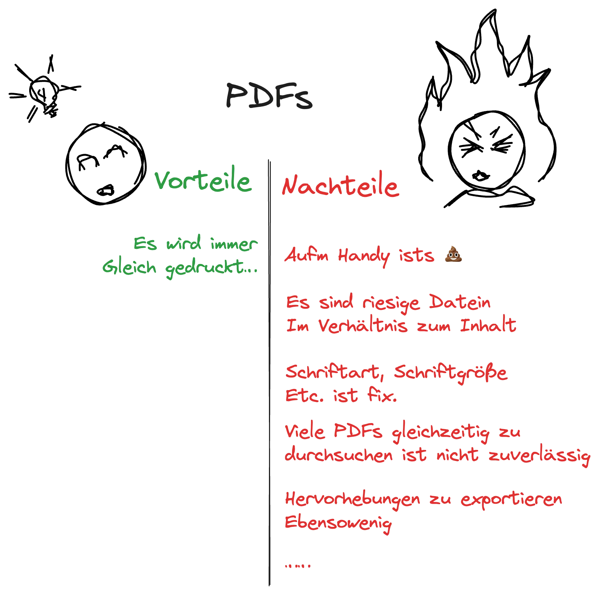
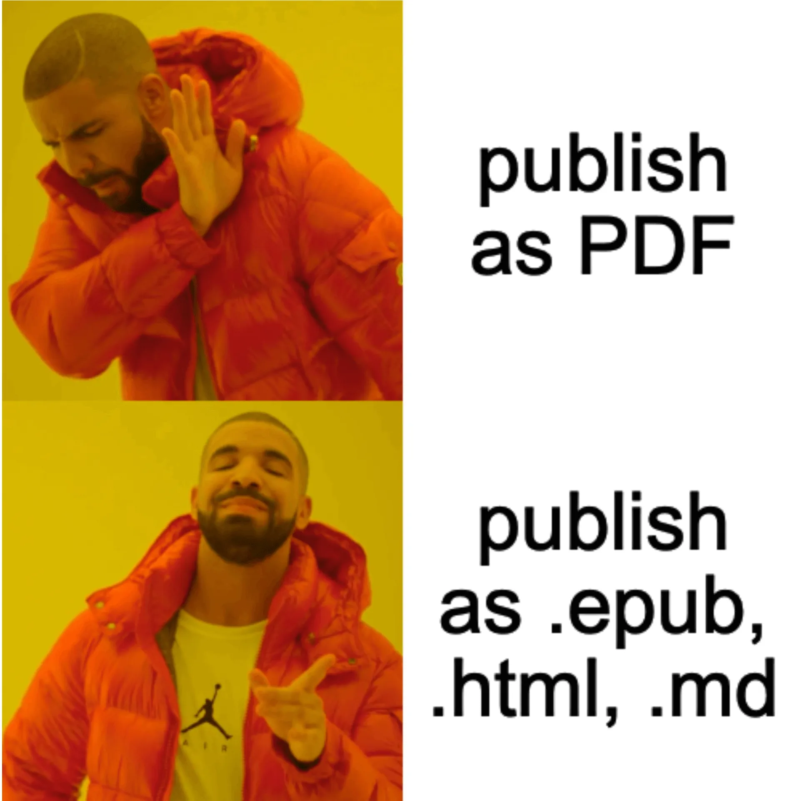

**Note:** Ich weiß nicht wie es euch geht aber mich frustriert es, wenn Textquellen nur im PDF-Format verfügbar sind. Es scheint immer noch viele Organisationen und Menschen zu geben, die ihre Inhalte ausschließlich in diesem Format veröffentlichen, ich bin kein großer Freund davon ... 

Hier ist eine kurze Zusammenfassung meiner Gedanken zu den Vor- und Nachteilen von PDFs. Spoiler: die Nachteile überwiegen 😼.

<figure style="text-align: center;"></figure>

Warum gibt es eigentlich immer noch so viele PDFs? Ehrlich gesagt, nerven sie mich. Klar, für bestimmte Anwendungsfälle wie das Drucken oder Präsentationen auf fremden Endgeräten sind PDFs eine tolle Sache. Sie sorgen dafür, dass egal von welchem Betriebssystem aus ich eine PDF-Datei öffnete, alles gleich formatiert und mit derselben Schriftart dargestellt wurde. Aber mal ehrlich, wer druckt denn heutzutage noch alles aus?

Früher, als Informationen hauptsächlich am PC oder Laptop mit oder ohne externen Monitor konsumierten oder sie eben ausgedruckt haben, waren PDFs vielleicht noch sinnvoll und hilfreich. Aber jetzt, wo wir fast alles digital lesen und je nach Ort und Gerät an unterschiedlich großen Bildschirmen sitzen, sind PDFs einfach nur nervig. Jeder, der schon mal versucht hat, in der U- oder anderen Bahnen ein PDF auf dem Handydisplay zu lesen, weiß genau, was ich meine.

Warum haben wir bei Internetseiten das Responsive Design entwickelt, das sich an die Bildschirmgröße anpasst, aber halten immer noch so stark an PDFs fest? Warum werden so viele Reports und Studien nur im PDF-Format veröffentlicht?

Es wäre wirklich praktischer, wenn Inhalte in einem flexibleren Format gespeichert werden würden. Ach was wäre es schön ein Format zu haben, das sich je nach Bildschirm- oder Fenstergröße sinnvoll darstellt und von jedem fähigen Reader, wie zum Beispiel einem Browser, problemlos gelesen werden kann. Spoiler: Diese Formate gibt es bereits, und schon länger z.B: EPUB, HTML oder Markdown, diese lassen sich besser an verschiedene Endgeräte konsumieren.

Ein weiterer Vorteil, der oft für PDFs genannt wird, ist ihre Unverfälschbarkeit. Allerdings ist das nicht ganz korrekt. Zwar kann ein PDF nicht so einfach manipuliert werden wie eine Word-Datei, HTML- oder Markdown-Datei, aber für kleinere Änderungen ist es durchaus möglich. Zudem können Dateien heutzutage digital signiert werden, um ihre Herkunft zu bestätigen. Daher bieten PDFs keine Vorteile gegenüber flexibleren Dateiformaten in Bezug auf Unverfälschbarkeit. Flexiblere Formate sind außerdem wesentlich einfacher durchsuchbar. Im Gegensatz zu PDFs ermöglichen sie eine effiziente Volltextsuche, auch über mehrere Dateien hinweg, was die Auffindbarkeit von Informationen erheblich verbessert, insbesondere wenn man viele Dateien gleichzeitig durchsuchen möchte. Zudem können Hervorhebungen und Markierungen in diesen Formaten wesentlich einfacher weiterverarbeitet werden. Man kann Textpassagen extrahieren, in andere Dokumente einfügen (auch automatisiert 😻) oder für spätere Referenzen speichern. Das erleichtert die Arbeit mit den Inhalten erheblich und spart Zeit und Aufwand.

Insgesamt ist es daher für mich nur schwer verständlich, warum immer noch so stark an PDFs festgehalten wird, obwohl wir fast alles digital lesen und uns an unterschiedlich großen Bildschirmen befinden. Responsive Design wurde für Internetseiten entwickelt, um sich an die Bildschirmgröße anzupassen, aber PDFs sind immer noch weit verbreitet. Ich würde es sehr begrüßen wenn wir uns von der Verwendung von PDFs lösen und stattdessen auf flexiblere Formate setzen würden, die besser an die moderne Art Texte zu konsumieren angepasst sind.

Also meine Bitte an euch liebe_r Leser_in: Wollt ihr Inhalte in Textform zur verfügung stellen? Bitte nicht als PDFs! oder zumindest nicht nur...🙏 

<figure style="text-align: center;"></figure>