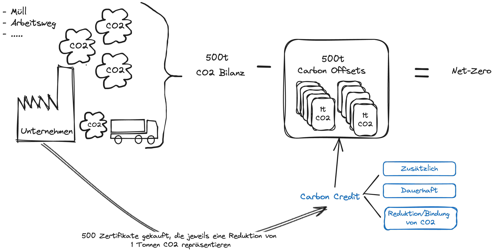

**TLDR**:
- Carbon Credits sind ein mehr oder weniger offizielles/standardisiert Versprechen, CO2 dauerhaft und zusätzlich zu binden oder zu reduzieren.
- Carbon Offsetting bezeichnet die Praxis Carbon Credits zu kaufen (jeglicher Art), um die eigenen CO2-Emissionen bilanziell; auf dem Papier auszugleichen.

<figure style="text-align: center;"></figure>

Carbon Offsets sind im Grunde Ausgleichszahlungen, die Organisationen oder Privatpersonen leisten, um ihren CO2-Fußabdruck bilanziell, also auf dem Papier, zu reduzieren. Sie funktionieren folgendermaßen: Man bezahlt andere Akteure dafür, Emissionen an anderer Stelle (in der Regel in Klimaschutzprojekten) zu reduzieren (z.B. durch den Ausbau erneuerbarer Energien) oder CO2 dauerhaft zu binden (z.B. durch Renaturierung von Mooren oder Waldprojekte). Wichtig ist, dass diese Projekte ohne die Ausgleichszahlungen nicht durchgeführt worden wären, da sie sonst nicht zu einer Netto-Reduktion der Emissionen der Organisation beitragen, die die Ausgleichszahlung leistet.

Die erzielte Reduktion bzw. Bindung wird in Form von Carbon Credits handelbar gemacht. Ökonomisch gesprochen, reduzieren Carbon Credits und der Handel mit ihnen die Transaktionskosten zwischen den Ausgleichszahler:innen und den Projektbetreiber:innen. Die Organisation, die CO2 bindet bzw. verspricht zu binden oder zu reduzieren, stellt für jede Tonne gebundenen CO2 ein Zertifikat aus - ein Carbon Credit. Dieser kann gekauft werden. Durch den Kauf wandert der erzeugte Carbon Credit vom Projektbetreiber in die Bilanz des:der Käufer:in und reduziert so deren CO2-Bilanz auf dem Papier um die Menge der gekauften Carbon Credits. Carbon Credits 

Randnotiz:
Ich finde den Begriff "Credit" wesentlich passender als "Zertifikat". Der Grund dafür ist, dass er sprachlich darauf hinweist, dass die Ausschüttung von CO2 oder anderen Treibhausgasen tatsächlich ein Kredit ist, den wir, insbesondere in Form fossiler Energieträger, von der ökologischen Umwelt nehmen. Je mehr wir von diesen "Krediten" in Anspruch nehmen, desto höher werden die "Zinsen", die wir als Gesellschaft (allerdings nicht die Emittenten allein oder anteilig, sondern am meisten die weniger Privilegierten) in Form von Klimafolgen (Stichwort Dürren, Starkregen, Hitzewellen, Wassermangel etc.) zu zahlen haben.

Das bedeutet, wir erschaffen Carbon Credits, um diese "Ökosystem-Kredite" auszugleichen. Wenn das an die Finanzkrise von 2008 erinnert, würde ich sagen:

<figure style="text-align: center;"></figure>

## Praktisches Beispiel

Nehmen wir als Beispiel eine Chemiefirma, die in ihrer Produktion Gas verbrennen muss und dabei CO2 freisetzt. Sie möchte zumindest bilanziell CO2-neutral sein. Diese Emissionen kann sie kompensieren, indem sie beispielsweise einen Teil eines Moores renaturieren lässt. Durch Untersuchungen kann man relativ genau bestimmen, wie viel CO2 ein Moor binden kann. Der Anbieter, der das Moor renaturiert, kann dann CO2-Zertifikate erstellen. Die Rechnung dabei ist einfach: Hat der Anbieter beispielsweise 10.000 Euro ausgegeben, um das Moor zu renaturieren und kann damit 500 Tonnen CO2 dauerhaft binden, könnte er, sofern er keinen Profit erwirtschaften möchte, das Zertifikat für je 20 Euro verkaufen. Wenn die Chemiefirma nun zufällig genau 500 Tonnen im letzten Jahr emittiert hat, aber behaupten möchte, dass sie Net-Zero bzw. bilanziell klimaneutral sind, müsste sie 500 Zertifikate kaufen. In diesem Fall würden 10.000 Euro von der Chemiefirma an die Organisation, die das Moor renaturiert hat, fließen. Alle sind glücklich, oder etwa nicht?

<figure style="text-align: center;"></figure>

Wer das herausfinden will, muss wohl den nächsten Beitrag lesen.