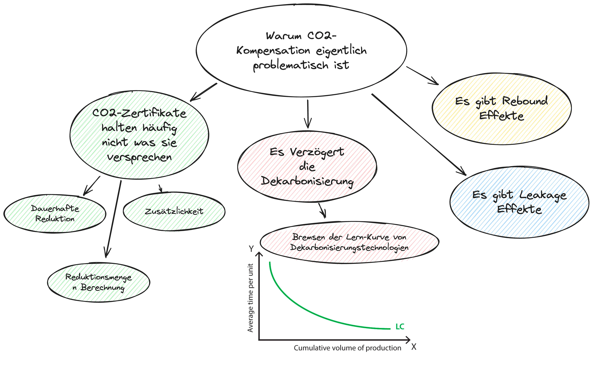

In diesem Beitrag wird die Frage Beantwortet warum Carbon Offsets/CO2-Kompensation eigentlich problematisch sind in der Art und weise wie sie heute hauptsächlich verwendet werden. Also schnappt euch einen Getränk, und lasst uns gemeinsam herausfinden, warum Carbon Offsets nicht immer das halten, was sie versprechen.

<figure style="text-align: center;"></figure>

## TL;DR: Die Kurzversion
- CO2-Kompensationen werden genutzt, um die eigene Klimabilanz aufzupolieren, indem man Zertifikate kauft, die theoretisch irgendwo auf der Welt Emissionen reduzieren.
- Problem: Nicht alle Carbon Credits garantieren eine dauerhafte und zusätzliche Reduktion von CO2.
- Die Nutzung von Kompensationen kann den notwendigen Wandel hin zu einer klimaneutralen Gesellschaft verzögern weil die Lern-Kurve für Decarbonisierungstechnologien/Geschäftsmodelle gehemmt wird und führt zu einer verzerrten Wahrnehmung von Klimaneutralität.

## Einleitung

Kompensationen werden von Privatpersonen, Organisationen oder Staaten angewandt, die ihre eigene CO2-Bilanz nominal verbessern möchten. Anders ausgedrückt: Wenn das Ziel darin besteht, weniger zum Klimawandel beizutragen, aber die Emissionen nicht vermieden oder reduziert werden können oder sollen, dann kauft man CO2-Zertifikate und kompensiert bzw. gleicht so die verursachten Emissionen aus. Die Zertifikate können auf freiwilligen CO2-Zertifikatsmärkten erworben werden.

**Randnotiz**: In diesem Artikel bzw. dieser Serie geht es nicht um den staatlich regulierten Emissionshandel, zum Beispiel der EU, USA, China. Dort werden zwar auch Emissionen gehandelt (wie der Name schon sagt), aber es dreht sich dort um verpflichtende Teilnehmer. Diese Organisationen erhalten jährlich eine bestimmte Anzahl an Emissionsberechtigungen (jede Berechtigung erlaubt das Ausstoßen von 1t CO2e), und wenn eine Organisation weniger benötigt, kann sie diese gewinnbringend an teilnehmende Organisationen verkaufen, die mehr CO2e emittieren möchten, als sie Berechtigungen erhalten haben. Dies ist jedoch ein eigenständiges Thema und wird in einem zukünftigen Artikel genauer beschrieben.

Dass der Markt für CO2-Zertifikate freiwillig und unreguliert ist, ist entscheidend für meine Einschätzung, warum die Art und Weise, wie Carbon Offsets aktuell verwendet werden, problematisch und teilweise sogar schädlich für die Bemühungen gegen den Klimawandel sind. Diese Einschätzung untergliedert sich in mehrere Argumente.

### Carbon Credits Halten Nicht Immer, Was Sie Versprechen
Das erste Argument, das gegen Carbon Offsetting spricht, ist, dass Carbon Credits nicht zwangsläufig halten, was sie versprechen. Warum nicht?
- Zur Erinnerung aus Teil 1 dieser Serie: Ein Carbon Credit repräsentiert eine Reduktion von 1t CO2e. Diese Reduktion muss permanent und zusätzlich sein.
- Warum halten nicht alle Carbon Credits dieses Versprechen ein? Es gibt verschiedene Gründe. Beginnen wir mit "neutralen" Gründen, ohne konkrete Akteure zu beschuldigen: die Permanenz der Reduktion.

#### Ist Die Reduktion Wirklich Permanent?
- Während einmal emittiertes CO2 mindestens über 100 Jahre seine erwärmende Wirkung entfaltet, ist dies bei den Reduktionsprojekten nicht immer der Fall.
- Es gibt Projekttypen (z.B. Ausbau erneuerbarer Energiequellen oder effizientere Energiegewinnung), die gut nachweisen können, dass tatsächlich Emissionen vermieden oder reduziert wurden. Andere, insbesondere Removals durch sogenannte naturbasierte Lösungen, sind unsicherer.
- Ob ein Wald, der durch ein Carbon Reduction Projekt finanziert wurde, wirklich über 100+ Jahre steht und nicht etwa durch Naturkatastrophen wie Waldbrände, Trockenheit oder anderes zerstört wird und damit das gespeicherte CO2 wieder freisetzt, kann man nicht mit Sicherheit sagen.
- Gleiches gilt für Moore oder "Blue-Carbon" Projekte, vereinfacht gesagt: alles, was mit Wasser und natürlicher CO2-Reduktion zu tun hat.

#### Ist Die Kompensation Wirklich Zusätzlich?
- Das Kriterium der Zusätzlichkeit von Carbon Credits ist zwingend für die Logik des freiwilligen CO2-Zertifikathandels. Warum? Das erklärte Ziel des freiwilligen Handels ist es, eine möglichst effektive Reduktion der Treibhausgase zu erzielen. Wenn es für Organisation A beispielsweise intern 100 Euro kosten würde, eine Tonne CO2 weniger zu emittieren, sie aber für 40 Euro ein CO2-Zertifikat kaufen kann (welches 1 Tonne CO2-Reduktion repräsentiert), ist es effektiver und kostengünstiger, in diesem Fall nicht intern die Emission zu vermeiden, sondern das Zertifikat zu kaufen (gleicher Effekt, aber günstiger).
- Damit diese Rechnung aufgeht (zumindest bezüglich gesparter Emissionen), muss die Reduktion wirklich zusätzlich sein, oder anders gesagt, ohne den Kauf des Zertifikats hätte das Reduktionsprojekt nicht durchgeführt werden dürfen. Wenn ein Reduktionsprojekt auf dem Ausbau erneuerbarer Energiequellen wie Windrädern oder Solarenergie basiert, dürften diese quasi nur durch die Finanzierung durch die Carbon Credits gebaut werden.
- Leider ist dies häufig nicht der Fall. So wurde beispielsweise in Indien festgestellt, dass 52% der Windräder auch ohne die Ausstellung und den Verkauf von Carbon Credits gebaut worden wären (siehe: https://www.cesifo.org/en/publications/2021/working-paper/do-carbon-offsets-offset-carbon).
- Laut Environmental Investigation Agency (EIA) wurden in Indonesien, Brasilien und China Reduktionsprojekte als nicht zusätzlich angesehen, weil die Waldpflanzungen und Schutzmaßnahmen unabhängig von den Credits durchgeführt worden wären.

Angesichts der rapide fallenden Preise für erneuerbare Energien pro kWh ist es meiner Einschätzung nach nur noch schwer zu argumentieren, warum erneuerbare Energieprojekte als Reduktionsprojekt gelten können.

#### Wie Viel CO2 Wird Einem Reduktionsprojekt Angerechnet?

Neben den qualitativen Kriterien der Permanenz und Zusätzlichkeit von Carbon Credits ist eine zentrale Frage, wie viel CO2 tatsächlich durch das Reduktionsprojekt eingespart wird und damit verbunden, wie viele Credits der Betreiber ausstellen kann. Der Betreiber hat ein Interesse daran, möglichst viele Credits auszustellen, da er bei gleichem Investment für die Umsetzung des Projekts mehr oder weniger Credits verkaufen kann und so seinen Umsatz steigert.

Während es für einige Reduktionsprojekte, insbesondere im Bereich erneuerbare Energien und effizientere Technologien, relativ einfach ist zu berechnen, wie viel CO2 gespart wird – zum Beispiel, wenn ein Kohlekraftwerk durch ein Wasserkraftwerk ersetzt wird oder ein um 50% effizienterer Gasherd eingebaut wird –, ist es besonders bei sogenannten „Nature-Based Solutions“, also Reduktionsprojekten durch Waldprojekte, Moore oder Ähnliches, sehr schwierig zu bestimmen, wie viel CO2 hier tatsächlich gespeichert wird. Drei Gründe dafür sind:

- **Vergleichsbasis**: Wenn zum Beispiel ein Wald gepflanzt oder ein Moor renaturiert wird, mit welchem intakten Wald oder Moor wird dieses dann verglichen? Aufgrund der Variabilität, die die Natur aufweist, sind Moore und Wälder nicht gleich und speichern damit auch nicht dieselbe Menge an CO2.
- **Methodische Ansätze**: Es gibt verschiedene Methoden zur Berechnung von Baselines und der Kohlenstoffbindung in Nature-Based Solutions-Projekten. Inkonsistenzen in der Methodik über verschiedene Projekte hinweg können Vergleiche und die Gesamtbewertung der Auswirkungen erschweren.
- **Verschiedene Kohlenstoffpools**: Nature-Based Solutions-Projekte können verschiedene Kohlenstoffpools innerhalb eines Ökosystems (Bäume, Boden usw.) beeinflussen. Das genaue Messen von Veränderungen in jedem Pool und deren Beitrag zur Gesamtkohlenstoffbindung fügt eine weitere Schicht an Komplexität hinzu.

Die Berechnung der Baseline kann schnell sehr technisch und kompliziert werden. Für diejenigen, die sich für die Details interessieren, berichtet dieser faszinierende YouTuber sehr genau über die Probleme bei der Baseline-Berechnung von Waldkompensationsprojekten: [Hier](https://www.youtube.com/watch?v=bfj6EkyO77I), untermauert mit zahlreichen Beispielen.

Man könnte nun denken, dass dies keinen großen Unterschied macht. Doch eine Untersuchung des Öko-Instituts hat ermittelt, dass die Mehrheit der Certified Emissions Reduction (CER) Projekte von 2013-2020 möglicherweise nicht so effektiv war wie beabsichtigt. Die Daten legen nahe, dass 85% der Projekte und 73% des potenziellen CER-Angebots während dieses Zeitraums eine geringe Wahrscheinlichkeit aufweisen, dass die Emissionsreduktionen zusätzlich und nicht überschätzt sind. Das bedeutet, dass diese Projekte möglicherweise nicht die Umweltvorteile bieten, die sie zu bieten behaupten. Nur ein kleiner Teil dieser Projekte wurde als sehr wahrscheinlich eingestuft, ihre versprochenen Emissionsreduktionen zu liefern. Speziell hatten nur 2% der Projekte und 7% des potenziellen CER-Angebots eine hohe Wahrscheinlichkeit, dass ihre Emissionsreduktionen zusätzlich und nicht überschätzt sind - das sins erschreckend niedrige Zahlen!

**Zwischenzusammenfassung: Carbon Credits Halten nicht Immer, Was Sie Versprechen...**
Weil sie entweder die Kriterien der **Permanenz** oder **Zusätzlichkeit** nicht erfüllen oder die **berechnete Baseline** und damit die Anzahl der ausgestellten CO2-Zertifikate ein höheres Reduktionspotenzial bescheinigt, als tatsächlich vorhanden ist. Deshalb ist die durch Carbon Offsets erworbene Net-Zero-/Klimaneutralität häufig nicht zutreffend. Diese Punkte werden auch in diesen zwei Videos aufgegriffen.
- [Last Week Tonight 2023 Carbon Offsets](https://www.youtube.com/watch?v=6p8zAbFKpW0&pp=ygUNQ2FyYm9uIG9mZnNldA%3D%3D) - große Empfehlung!
- [DW Planat A - Why Carbon Offsets are worse than you think](https://www.youtube.com/watch?v=61SWIYwCaSE) gute Zusammenfassungs insbesondere der Nature-Based Reduktionsprojekte wie Wald-Aufforstung

### Der Freiwillige Kohlenstoffmarkt Verzögert Den Wandel Hin Zur Klimaneutralität
Ein weiterer Grund und meiner Meinung die relevanteste Problematik, warum Carbon Offsetting, also die Praktik des Kompensieren selbst, problematisch ist, liegt in der Annahme, dass es den Wandel zur Klimaneutralität verzögert. Dies lässt sich am besten an einem Beispiel erklären: 

Nehmen wir zwei Unternehmen, die Chemikalien herstellen, die beispielsweise für Medikamente benötigt werden. Für die Produktion wird große Hitze benötigt, die nicht durch Erdwärme oder Sonnenenergie erzeugt werden kann, sondern Gas erfordert. Eine wirklich CO2-neutrale Alternative, wie zum Beispiel Wasserstoff, der anstelle von Erdgas verbrannt wird, ist noch nicht marktreif, und es bedarf entsprechender Infrastruktur, um Wasserstoff bis zur Chemiefabrik zu transportieren. Unternehmen A investiert in Forschung und Entwicklung, um die Umstellung auf Wasserstoff vorzunehmen und so seine Emissionen zu reduzieren. Unternehmen B hingegen kompensiert die durch Erdgas verursachten Emissionen. Auf dem Papier ist Unternehmen B klimaneutral, und falls Unternehmen A ebenfalls klimaneutral sein möchte, hat es wesentlich höhere Kosten, da es in Entwicklung investiert. Dies führt dazu, dass es bei sonst gleichen Ausgaben einen höheren Preis verlangen müsste und somit weniger wettbewerbsfähig wäre. Das Kompensieren führt also dazu, dass Investitionen in klimafreundlichere Technologien oder Geschäftsmodelle unterbleiben. Eine frühe Investition ist jedoch notwendig, da, wie im Beispiel beschrieben, Infrastrukturmaßnahmen nicht von heute auf morgen entstehen und solche Technologien notwendig sind, um weltweit wirklich (und nicht nur bilanziell) Klimaneutralität zu erreichen, was insbesondere für Länder des Globalen Südens sonst nur schwer finanzierbar ist (siehe: [Hannah Ritchie - Small Emitters](https://www.sustainabilitybynumbers.com/p/small-emitters) >> Große Empfehlung sich mit anderen Aritkeln dieser Frau zu beschäften!!) .

Der Grund, warum frühe Investitionen in klimafreundliche Technologien diese für weniger wohlhabende Regionen finanzierbar machen, basiert auf der "Lernkurve". Dies lässt sich gut an den sinkenden Preisen für Solarmodule zeigen.  

Die Idee dahinter ist einfach: Wenn sich die installierte Solarkapazität verdoppelt, sinkt der Preis pro kWp Solarmodul um 20%.

Wenn ich jetzt als Unternehmen oder andere Organisation meine CO2-Emissionen kompensiere (zum Beispiel, weil es günstiger ist als Solarmodule zu kaufen und zu installieren), dann kann dieser Kostenreduktionseffekt (Lernkurveneffekt) gesellschaftlich nicht so umfänglich erzielt werden, wodurch nicht erneuerbare Energieträger wettbewerbsfähiger bleiben. Gleichzeitig benötigen wir den Lernkurveneffekt, damit wir real die Dekarbonisierung langfristig für die gesamte Welt schaffen – was nur möglich ist, wenn die notwendige Technologie kostengünstig, robust und langlebig ist – und nicht nur auf dem Papier oder bilanziell für einzelne Unternehmen. Wenn jedoch, wie bei der Solarenergie mittlerweile der Fall, genügend Kapazität installiert wurde und der Lernkurveneffekt stark genug war, wird diese klimafreundlichere Technologie günstiger als zum Beispiel fossile Energieträger.

Wie sieht es nun in der Praxis aus? Vermeiden Unternehmen ihre Emissionen, indem sie zum Beispiel klimafreundliche Technologien implementieren, oder kompensieren sie doch eher ihre Emissionen? Basierend auf der investigativen journalistischen Arbeit der Zeit und des Guardian wird deutlich, dass viele Unternehmen massiv zu den kostengünstigeren Kompensationen greifen und gleichzeitig die realen Emissionen von vielen (großen) Unternehmen weltweit sogar zunehmen. Sie vermeiden und reduzieren also weniger, sondern kompensieren stattdessen in größerem Stil.
- Ein Artikel der Zeit vom letzem Jahr: [Hier](https://www.zeit.de/2023/04/co2-zertifikate-betrug-emissionshandel-klimaschutz/)
- Ein Artikel des Guardian letzem Jahr: [Hier](https://www.theguardian.com/environment/2023/sep/19/do-carbon-credit-reduce-emissions-greenhouse-gases))

Sie halten also an ihrem Geschäftsmodell fest, welches immer mehr den Klimawandel verstärkt, und erkaufen sich Klimaneutralität und das grüne Umweltimage durch CO2-Zertifikate.

**Die Konsequenzen sind zweierlei:**
- **a)** Unternehmen, die kostenintensive (jedoch gesellschaftlich wertvolle) Maßnahmen zur Vermeidung ihrer Emissionen ergreifen, sind entweder bei gleich viel investiertem Geld nicht klimaneutral oder müssen wesentlich mehr Geld aufbringen. In beiden Fällen sind sie weniger wettbewerbsfähig. Und
- **b)** [Carbon Credits halten häufig nicht was sie Versprechen](#carbon-credits-halten-nicht-immer-was-sie-versprechen): Wegen der Probleme der CO2 Zertifikate selbst sind Unternehmen die für jede emittierte CO2 Tonne ein Zertifikat kaufen häufig gar nicht klimaneutral und verstärken so die Wettbewerbsverzerrung, da ein großer Teil der günstigen, Natur-Based Zertifikate aufgrund der fehlenden Permanenz, Zusätzlichkeit und falscher Baseline-Berechnung weniger CO2 kompensiert, als sie versprechen – und das viel weniger.

### Rebound Effekte+

Ein weiterer Grund, warum CO2-Kompensationen problematisch sind, sind die Rebound-Effekte. Rebound-Effekte sind unbeabsichtigte Konsequenzen der Umsetzung von Richtlinien oder Verhaltensänderungen, die zu einer teilweisen oder vollständigen Umkehr der beabsichtigten Vorteile führen können. Diese Effekte werden in verschiedenen Kontexten beobachtet, wie zum Beispiel beim Energieverbrauch, Verkehr und Ressourcenschutz. Zum Beispiel: Nach dem Kauf einer energieeffizienteren Heizung erhöhe ich vielleicht die Durchschnittstemperatur, wodurch die Energieeinsparungen zumindest teilweise wieder zunichte gemacht werden. Oder ein persönliches Beispiel: Ich habe das Glück, an die Geothermie-Fernwärme angeschlossen zu sein. Freue ich mich darüber, dass meine verbrauchte Wärme ziemlich klimafreundlich ist? Ja. Dusche ich deshalb immer wieder länger und heißer? Definitiv. Diese Effekte sind insbesondere auf der Ebene individueller Konsumenten erforscht worden.

Wie können sich solche Rebound-Effekte in Bezug auf Carbon Offsets einstellen? Aus der Perspektive der Konsumenten kann die Annahme, dass ein Produkt "klimaneutral" ist, dazu führen, dass sie es konsumieren, ohne über dessen tatsächliche Umweltauswirkungen nachzudenken. Ähnlich kann ein Unternehmen, das sich als "klimaneutral" betrachtet, dazu verleitet werden, umweltschädlichere Praktiken, wie mehr Inlandsflüge, zu übernehmen, da es glaubt, dass seine Emissionen bereits ausgeglichen sind. Darüber hinaus kann das Label "klimaneutral" den Fortschritt eines Unternehmens suggerieren, der in Wirklichkeit nur außerhalb und unabhängig vom Unternehmen selbst existiert. Dies kann dazu führen, dass solche Unternehmen fälschlicherweise mit solchen gleichgesetzt werden, die tatsächlich ihre Emissionen reduzieren, was ein verzerrtes Bild der tatsächlichen Bemühungen zur Bekämpfung des Klimawandels vermittelt.

Ein weiterer Effekt, der ein ähnliches Resultat wie die Rebound-Effekte hat, nämlich dass die Einsparungseffekte an anderer Stelle "aufgebraucht" werden, ist der Leakage-Effekt. Dieser tritt insbesondere bei Waldprojekten auf und lässt sich ungefähr so beschreiben: Der Schutz alter Wälder, die wertvoll für den Klimaund Artenschutz sind, garantiert nicht, dass die Nachfrage nach Holz und landwirtschaftlichem Land nicht auf andere, manchmal direkt angrenzende Standorte verlagert wird, was zu Entwaldung und Landnutzungsänderungen führt. Der Schutz ganzer Landschaften adressiert dieses Problem besser als einzelne Projekte, die auf CO2-Gutschriften abzielen. Annahmen, dass CO2 ohne Schutz emittiert worden wäre, was impliziert, dass der Wald zerstört worden wäre, wenn er nicht durch den Kauf von Zertifikaten gerettet worden wäre, sind schwer zu überprüfen.

Dies war ein mitentscheidender Faktor für die Entscheidung der UN, den Waldschutz nicht in ihr staatliches Kompensationsprogramm im Kyoto-Protokoll von 1997 aufzunehmen. Ähnlich konzentrieren sich "Gold Standard"-Kompensationsprojekte, die von mehreren NGOs (z.B. WWF) im Jahr 2003 initiiert wurden, auf Solarinstallationen und Baumpflanzungen anstatt auf den Waldschutz.

## Zusammenfassung
Die Praxis der CO2-Kompensationen, auch bekannt als Carbon Offsets ist problematisch aus verschiedenen Gründe, meiner Ansicht nach der am schwerwiegendste: Sie kann den dringend notwendigen Wandel hin zu einer klimaneutralen Gesellschaft verzögern. Der Kern dieses Problems liegt darin, dass die Nutzung von Kompensationen die Lernkurve für Decarbonisierungstechnologien oder Geschäftsmodelle hemmt. Anstatt in die Entwicklung und Implementierung nachhaltiger Technologien oder Geschäftsmodelle zu investieren, die langfristig zu einer Reduktion der Treibhausgasemissionen führen könnten, ermöglichen Carbon Offsets Unternehmen und Individuen, ihre Emissionen auf dem Papier auszugleichen, ohne tatsächliche Veränderungen in ihrem CO2-Fußabdruck vorzunehmen. Dies führt nicht nur zu einer verzerrten Wahrnehmung von Klimaneutralität, sondern verzögert auch den klimafreundlicher Fortschritt und die gesellschaftliche Anpassung, die für die Bewältigung der Klimakrise unerlässlich sind.

Darüber hinaus ist die Effektivität vieler Carbon Credits fragwürdig, da nicht alle die Kriterien der Permanenz und Zusätzlichkeit erfüllen und die Berechnung der tatsächlich eingesparten CO2-Mengen oft unzureichend ist. Insbesondere naturbasierte Lösungen wie Aufforstung oder Moorschutzprojekte stehen in der Kritik, da ihre langfristige CO2-Bindung nicht immer gewährleistet ist. Zudem können Rebound-Effekte und Leakage-Effekte die positiven Umweltauswirkungen von Kompensationsmaßnahmen zusätzlich mindern. Diese Erkenntnisse unterstreichen die Notwendigkeit, den Fokus verstärkt auf direkte Emissionsreduktionen und den Ausbau erneuerbarer Energien zu legen, um eine wirkliche und nachhaltige Verringerung der Treibhausgasemissionen zu erreichen und den Weg zu einer klimaneutralen Gesellschaft nicht zu behindern.
