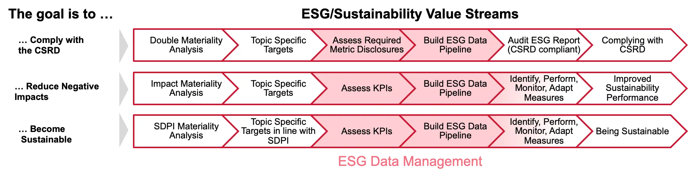

Dieser Beitrag ist ein Repost des Originalartikels, welHen ich  am 1. August im Rahmen meiner Arbeit [hier](https://www.cgi.com/de/de/blog/nachhaltigkeit/esg-datenmanagement-warum-unverzichtbar-und-wie-aufbauen) veröffentlicht habe.

### TLDR:
Ohne ESG-Datenmanagement ist es unmöglich, die Einhaltung von Vorschriften zu gewährleisten oder die Nachhaltigkeitsleistung zu verbessern. Um ein funktionales ESG-Datenmanagementsystem zu erreichen, sind drei Eckpfeiler unerlässlich:
- Relevante ESG-Metriken identifizieren
- Ownership-Driven ESG Data Governance
- Inkrementelle Entwicklung/Verbesserung einzelner Datenpipelines

In der sich schnell entwickelnden Landschaft der Unternehmensnachhaltigkeit ist ESG- (Environmental, Social, and Governance) Datenmanagement nicht nur ein Schlagwort, sondern ein Eckpfeiler für jede Organisation, die ESG oder Nachhaltigkeitsziele verfolgt. Obwohl es nicht das faszinierendste Thema im Bereich IT und Nachhaltigkeit ist, kann seine Bedeutung nicht ausreichend hervorgehoben werden. Das ESG-Datenmanagement ermöglicht effizientes Reporting, das Controlling von Nachhaltigkeitsinitiativen stellt sicher, so dass die Bemühungen tatsächlich zu ESG und Nachhaltigkeitszielen beitragen. Es geht nicht nur um Compliance, sondern es geht darum, Nachhaltigkeit sichtbar, umsetzbar und operativ zu machen.

## Die Entscheidende Rolle und Komplexität des ESG-Datenmanagements
Stellen Sie sich vor, Sie wollen Ihre Gesundheit verbessern, ohne jemals Ihren Blutdruck zu messen oder Ihre Ernährung aufzuschreiben. Klar, Sie könnten durch Ausprobieren und Best Practices ein bisschen weiterkommen, aber ohne Mess-Daten wären Ihre Bemühungen wahrscheinlich weniger effektiv und Sie würden viele Chancen zur Verbesserung verpassen. Genauso verhält es sich auch mit dem ESG-Datenmanagement in Unternehmen.

Im Kern geht es beim ESG-Datenmanagement darum, fundierte Entscheidungen zu ermöglichen und die erforderlichen ESG-Datenpunkte dafür und für die Einhaltung von Reporting-Vorschriften zu erhalten. Es ermöglicht Organisationen, Daten über ihre Umwelt-, Sozial- und Governance-Auswirkungen zu aggregieren und komplexe Informationen in umsetzbare Erkenntnisse zu verwandeln. Dies ist unerlässlich, um Vorschriften einzuhalten oder wirksame Maßnahmen zur Reduzierung negativer Auswirkungen zu entwerfen und zu kontrollieren, wie die folgenden Value Streams veranschaulichen.

<figure style="text-align: center;"></figure>

Leider ist der Weg zum effektiven ESG-Datenmanagement mit Herausforderungen gespickt, da es in alle Unternehmensbereiche und -praktiken eingebettet ist, einschließlich Liefer- und Wertschöpfungsketten. Es erfordert die Sammlung von Daten über eine Vielzahl von Aktivitäten, von Energieverbrauch und Abfallproduktion bis hin zu Mitarbeiterdiversität, Corporate-Governance-Praktiken und Menschenrechten in der Lieferkette. Die Komplexität wird durch unterschiedliche Datenqualität und -zugänglichkeit, die komplexe und dynamische regulatorische Landschaft und die Notwendigkeit spezieller Fähigkeiten zur Interpretation und Umsetzung der Daten weiter verstärkt. Darüber hinaus integrieren sich die meisten ESG-Softwarelösungen nicht nahtlos in bestehende Unternehmens-IT-Landschaften, was die Komplexität und den Aufwand für die Implementierung eines effektiven ESG-Datenmanagements erhöht.

## Herausforderungen Im ESG-Datenmanagement überwinden
Organisationen können diese Herausforderung meistern und ein effektives ESG-Datenmanagement einführen, das zu ihren individuellen Bedürfnissen und Gegebenheiten passt, indem sie die folgenden wesentlichen Punkte beachten:

### Relevante Metriken Identifizieren
Der erste Schritt besteht darin, zu bestimmen, welche ESG-Metriken für die Ziele Ihrer Organisation und die Erwartungen der Stakeholder am relevantesten sind. Dies erfordert ein tiefes Verständnis ihrer Betriebsabläufe, Branchenstandards und regulatorischen Anforderungen. Zum Beispiel könnte sich ein Fertigungsunternehmen auf Metriken im Zusammenhang mit Energieverbrauch, Abfallproduktion und Emissionen konzentrieren, während ein Finanzdienstleistungsunternehmen Metriken im Zusammenhang mit Governance-Praktiken und die Einflüsse ihrer Assets priorisieren könnte. Die Identifizierung der Qualität und Tiefe der Rohdaten, die erforderlich sind, um diese ESG-Datenpunkte und KPIs zu aggregieren, ist entscheidend. Dies bedeutet nicht nur zu wissen, welche Daten zu sammeln sind, sondern auch die Quellen dieser Daten zu verstehen und deren Genauigkeit und Zuverlässigkeit sicherzustellen.

### Ownership-driven ESG Data Governance
Umfassende Prozessabläufe von Datenquellen bis hin zu aggregierten KPIs zu erstellen, ist entscheidend. Dabei geht es darum, jeden Schritt zu verstehen, der notwendig ist, um die erforderlichen KPIs und Datenpunkte zu aggregieren, sowie die verantwortliche Person für jeden Schritt zu identifizieren. Dies gilt sowohl für bestehende als auch für derzeit fehlende, aber gewünschte ESG-KPIs.

Zum Beispiel könnte in einem Einzelhandelsunternehmen der Prozessablauf mit der Datenerfassung in den einzelnen Filialen zu Energieverbrauch und Abfallmanagement beginnen, wobei spezifische Rollen und Personen für diese Aufgaben verantwortlich sind. Danach erfolgt die Aggregation auf regionaler Ebene und schließlich die Konsolidierung auf Unternehmensebene. Obwohl diese Schritte automatisiert sind, ist eine bestimmte Person dafür verantwortlich, sie zu überwachen und auftretende Probleme zu lösen. Eine Ownership-driven ESG-Daten-Governance stellt sicher, dass Verantwortlichkeiten und Klarheit im Datenmanagementprozess gewährleistet sind. Jede Beteiligte Person, von den Datensammlern bis zu den Analysten, muss seine Rolle und Verantwortung verstehen. Diese Governance-Struktur hilft, die Datenintegrität zu wahren und einen nahtlosen Datenfluss innerhalb der Organisation zu ermöglichen.

### Inkrementelle Verbesserung
Die Nutzung von ESG Data Governance als Projekt-Backlog ermöglicht inkrementelle Verbesserungen in den ESG-Datenaggregationsprozessen. Dies stellt sicher, dass die gewünschten KPIs in der benötigten Qualität erhalten werden, was genauere und operationalisierbar Erkenntnisse ermöglicht. Zum Beispiel könnte ein Unternehmen damit beginnen, grundlegende Metriken wie den Energieverbrauch zu verfolgen und schrittweise zu komplexeren Metriken wie dem CO2-Fußabdruck und der Nachhaltigkeit der Lieferkette übergehen. Durch die kontinuierliche Verfeinerung der Datensammlung und Verarbeitungsprozesse können Organisationen die Genauigkeit und Relevanz ihrer ESG-Berichterstattung verbessern. Dieser iterative Ansatz ermöglicht die Identifizierung von Lücken und Chancen und stellt sicher, dass sich das ESG-Datenmanagementsystem im Einklang mit den Nachhaltigkeitszielen der Organisation weiterentwickelt.

## Fazit: Strategische Bedeutung des ESG-Datenmanagements kann nicht überschätz werden
Es ermöglicht die Erreichung von ESG- und Nachhaltigkeitszielen, von der Einhaltung der EU-Berichtsvorschriften bis hin zur Reduzierung negativer Auswirkungen und der Erreichung von Nachhaltigkeit. Um ein effektives ESG-Datenmanagement zu aufzubauen, sollten Unternehmen die relevanten ESG-Metriken in Bezug auf die erforderliche Datenqualität und -tiefe identifizieren, eine Ownership-Driven ESG Data Governance einrichten, die alle benötigten KPIs und Datenpunkte abdeckt, und schließlich ESG-Datenpipelines inkrementell aufbauen und erweitern.