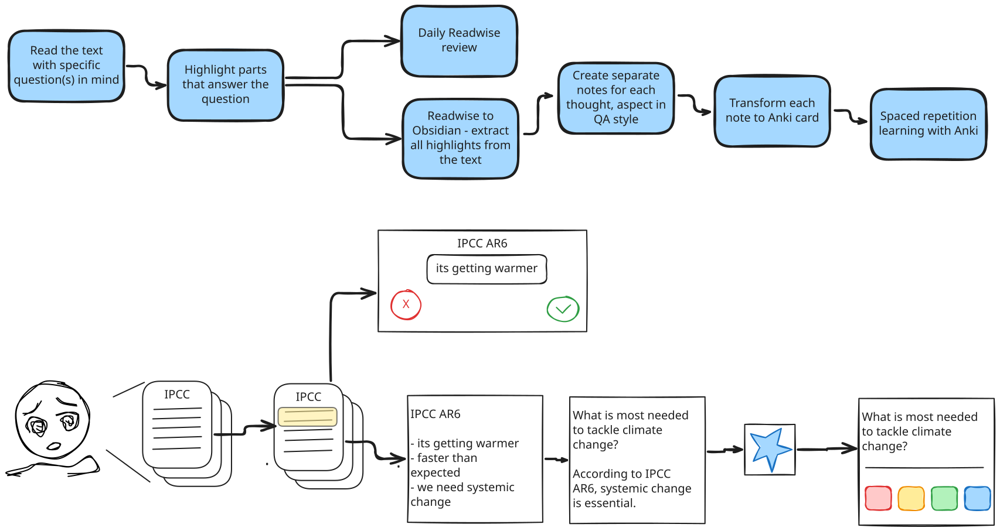

## TLDR
Ich finde es toll, zu lesen und Neues zu lernen, aber häufig blieb schon nach ein paar Tagen kaum noch etwas Konkretes hängen. Nach viel Try and Error habe ich einen Prozess entwickelt, der mir hilft, Informationen die ich spannend finde besser zu behalten und gleichzeitig mehr Spaß dabei zu haben. Vielleicht geht es euch ja ähnlich, und ihr sucht nach Wegen, das Gelernte langfristig zu verankern. Hier sind die sechs Schritte, die mir dabei helfen:

1. Mit klaren Fragen im Kopf lesen
2. Wichtige Stellen mit Readwise markieren
3. Tägliche Reviews machen und Notizen in Obsidian sammeln
4. "Atomic Notes" für einzelne Gedanken erstellen
5. Notizen in Anki-Karten umwandeln
6. Mit Anki-Karten lernen und wiederholen

Ahoi! Wenn ihr wie ich gerne lest, um Neues zu lernen oder euer Wissen zu vertiefen aber schon nach wenigen Tagen dich nur noch sehr wenig konkretes erinnern kannst, dann könnte dieser Beitrag spannend für euch sein.

Ich liebe es zu lesen! Egal ob zur Unterhaltung oder um mein Wissen zu erweitern. Doch während ich beim Lesen zur Unterhaltung keine großen Ansprüche habe, sieht das beim Lernen ganz anders aus. Seit meiner Schulzeit war ich oft unzufrieden mit meiner Fähigkeit, Informationen aus Texten zu behalten. Ich war langsamer als meine Mitschüler und konnte weniger aus den Texten mitnehmen. Auch im Studium änderte sich das nicht wirklich. Die Texte waren oft lang und kompliziert geschrieben (ja, ich rede von dir, deutsche Soziologie!). Also dachte ich mir, ich muss schneller werden. Ich habe einige Speed-Reading-Kurse ausprobiert, aber die waren nicht wirklich erfolgreich. Dies hat mich insgesamt ziemlich frustriert.

Was mir jedoch wirklich geholfen hat, und vor allem den Spaß beim Lesen und Lernen massiv erhöht hat, war ein Umdenken: Nicht schneller lesen, sondern besser behalten - auf lange Sicht! Das Buch "Smart Notetaking" zu lesen, hat mir die Augen geöffnet. Für mich geht es darum, das Gelesene aktiv in mein bestehendes Wissen zu integrieren und so konkret wie möglich zu behalten. Hier ist mein Prozess im Detail:

## Der Lese (und Lern) Prozess

<figure style="text-align: center;"></figure>

### Schritt 1: Lesen Mit Fragen Im Kopf

Bevor ich mit dem Lesen beginne, überlege ich mir eine oder mehrere Fragen, die ich durch den Text beantworten möchte. Diese Fragen helfen mir, den Fokus zu behalten und gezielter nach Informationen zu suchen, die für mich relevant sind.

### Schritt 2: Markieren Mit Readwise

Während des Lesens markiere ich wichtige Passagen mit Readwise. Hierbei möchte ich zwei Dinge anmerken:

- **Hervorheben ist nicht die effektivste Lerntechnik:** Laut einer Meta-Studie von [John Dunlosky et al.](https://journals.sagepub.com/doi/abs/10.1177/1529100612453266) (alle Verweise auf die Effizienz von Lerntechnicken basieren auf dieser Studie) ist das Hervorheben von Texten keine besonders effiziente Methode, um Informationen zu behalten. Meine persönliche Erfahrung bestätigt das – leider habe ich so meine Studien bestritten. NAJA…
- **Umfangreiches Markieren:** Anders als in der Schule oder Uni gelernt markiere ich nicht nur Stichworte oder Kernaussagen, sondern so viel, dass ich die Aussage auch später ohne Kontext verstehen kann. Warum das wichtig ist, erkläre ich im nächsten Schritt.

### Schritt 3: Tägliche Reviews Und Notizen in Obsidian

Nach dem Markieren passieren zwei Dinge unabhängig voneinander:

- **Tägliche Reviews mit Readwise:** Fast täglich nutze ich die Funktion von Readwise, die mir einige meiner Markierungen erneut präsentiert. Diese "Daily Reviews" kombinieren zwei Lerntechniken: das wiederholte Lesen (wenig effektiv) und das zeitlich verteilte Wiederholen (sehr effektiv). So werde ich immer wieder an wichtige Passagen erinnert.
- **Integration in Obsidian:** Alle Markierungen werden dank Readwise automatisch in Obsidian importiert, wo für jeden gelesenen Text eine Notiz mit allen Highlights erstellt wird. Hier ist es wichtig, dass die markierten Stellen so umfangreich sind, dass sie den Gedanken verständlich wiedergeben. Das hilft sowohl bei den Readwise-Reviews als auch im nächsten Schritt.

### Schritt 4: Erstellen Von Atomic Notes

Nachdem die Notiz in Obsidian erstellt wurde, gehe ich sie durch und erstelle für alle spannenden Markierungen oder Kombinationen daraus sogenannte "Atomic Notes". Diese Notizen enthalten jeweils(so der Plan - geht nicht immer auf…) nur einen Gedanken. Wenn es mehrere zusammenhängende Gedanken gibt, werden sie (später) auf mehrere Notizen aufgeteilt und miteinander verlinkt.

- **QA-Style:** Jede dieser Notizen ist im Frage-Antwort-Stil strukturiert. Ich formuliere eine Frage, die mit der Markierung beantwortet werden kann, und formuliere den Inhalt der Markierung so um, dass sie die Frage beantwortet. Falls ich beim Antworten feststelle, dass die Frage zu unspezifisch ist, verbessere ich die Formulierung.

### Schritt 5: Anki-Karten Erstellen

Mit der Zeit sammeln sich viele Notizen an, und dank meines "Sieb-Gehirns" vergesse ich schnell, was ich aufgeschrieben habe Dann bleibt häufig nur hängen: Darüber habe ich schonmal was gelesen … mehr Information gibt mir dann mein Hirn nicht. Hier kommt Anki ins Spiel:

1. **Anki als digitales Karteikartensystem:** Jede Notiz im QA-Style wird in Anki als Karteikarten erstellt. Die Frage wird zur Kartenvorderseite und die Antwort zur Kartenrückseite. Die Karten werden von Anki basierend auf einem Algorithmus in regelmäßigen Abständen angezeigt. Wer sich für den Algorithmus Interessiert - der_dem sei das subreddit r/Anki empfohlen. Diese Anki kombiniert die effektivsten Lernmethoden: den Praxistest (Karteikarten) und die zeitlich verschobene Wiederholung (Spaced Repetition).
2. **Automatisierung mit Python:** Ich bin faul… daher habe ich ein kleines Python-Skript geschrieben welches die Notizen in Anki überträgt. Es durchsucht alle Dateien in Obsidian nach einem bestimmten tag (bei mir "permanent_note") und erstellt Anki-Karten aus den QA-Notizen.

3. **Integration und Nutzung:** Jedes Mal, wenn ich Anki (am PC) öffne, wird das Skript ausgeführt und alle neuen QA-Notizen werden als Anki-Karten übertragen. So habe ich immer neue Karten auf allen Geräten und kann sie jederzeit in der Umgebung von Anki wiederholen. Ein Link zur Obsidian-Datei ist ebenfalls enthalten, falls ich den Kontext der Notiz noch einmal genauer anschauen oder anpassen möchte.

### Schritt 6: Anki-Karten Lernen:
Der letzte Schritt besteht darin, 5-15 Minuten (je nach Lust, Laune und Zeit) die von Anki angezeigten Karten durchzugehen. Je nachdem, wie leicht oder richtig mir die Antwort gefallen ist, verändert sich das Intervall, wann mir die Karte wieder angezeigt wird.

## Ein Konkretes Beispiel
Damit der Prozess nicht so generisch ist, hier ein konkretes Beispiel von einem Text welchen ich kürzlich gelesen habe:

<figure style="text-align: center;"></figure>
(PS: Hannah Ritchy - beste Frau!! ich bin Fan Boy, große Empfehlung ist ihr Buch https://www.nottheendoftheworld.co.uk/)

**Schritt 1: Lesen mit Frage im Kopf:** Meine Frage war "Wieso ist es der Prozess wie KlimaZiele erreicht werden wichtig" Während des Lesens habe ich verschiedene Passagen gefunden, die ich besonders spannend fand. Eine dieser Passagen war:

**Schritt 2 Markieren:** Ich habe diese Passage hervorgehoben und weitergelesen.
<figure style="text-align: center;"></figure>

**Schritt 3 Tägliche Reviews** Diese markierten Passagen tauchen nun in unregelmäßigen Abständen in meinem täglichen Readwise-Review auf, wie hier zu sehen:
<figure style="text-align: center;"></figure>

**Schritt 3 Obsidian Notiz** Gleichzeitig importiert meine Notiz-App Obsidian automatisch alle Markierungen aus dem Artikel. Das sieht dann ungefähr so aus:
<figure style="text-align: center;"></figure>
Hier seht ihr die im Reader hervorgehobene Passage (Zeile 17 mit dem blauen Balken).

**Schritt 4 Erstellen von Atomic Notes:** Beim Durchsehen der Inhalte fand ich diese Passage immer noch so spannend, dass ich dazu eine eigenständige Notiz verfasst habe. Diese trägt den Titel: "CO2 Budget is a question of 'area' (process) not of 'point' (goal)" und sieht so aus:
<figure style="text-align: center;"></figure>

**Schritt 5 Anki-Karten Erstellen:** Diese Notiz wird dann von meinem Skript aufgenommen und in eine Anki-Karte umgewandelt:
<figure style="text-align: center;"></figure>
**Schritt 6 Anki-Karten Lernen** Hier ist die Antwort auf der Rückseite der Karte. Da ich die Antwort noch ziemlich gut wiedergeben konnte, drücke ich auf "Good" und in vier Tagen wird mir die Karte erneut angezeigt.
<figure style="text-align: center;"></figure>

## Fazit

Das ist mein Lese-Prozess! Er ist das Ergebnis von viel Ausprobieren und wird sich sicherlich noch weiterentwickeln. Aber er hilft mir, das Gelesene nicht nur zu verstehen, sondern auch aktiv in mein Wissen zu integrieren.

Es geht mir nicht darum, dass ihr diesen Prozess eins zu eins übernehmt. Vielmehr hoffe ich, dass er euch inspiriert, über eure eigenen Lese- und Lerngewohnheiten nachzudenken. Wenn dieser Beitrag euch dazu anregt, neue Ansätze zu entdecken, die für euch funktionieren, dann bin ich sehr zufrieden!